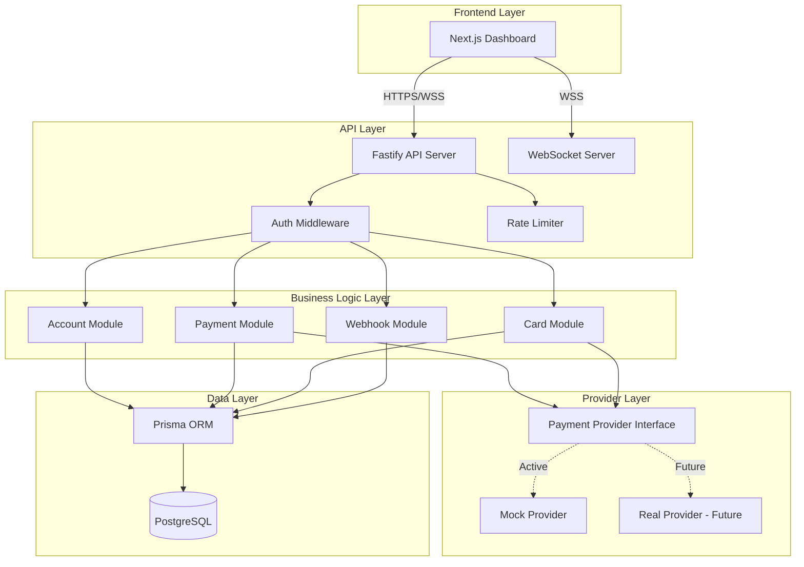
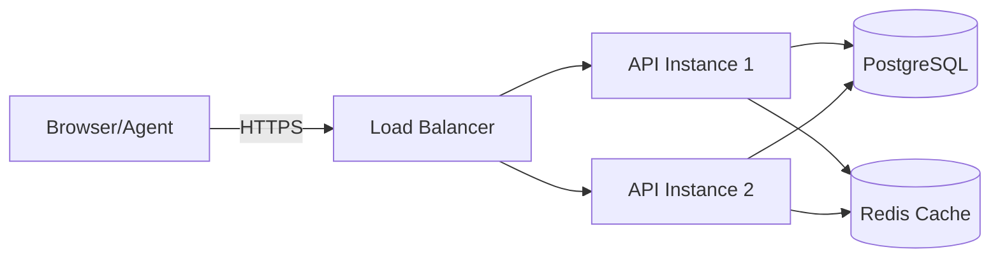

# Design Document: AI Agent Banking Platform

## Overview

The AI Agent Banking Platform is a full-stack TypeScript application that provides banking services exclusively for AI agents. The system consists of three main components:

1. **Backend API** (Fastify + TypeScript): RESTful API with WebSocket support for real-time events
2. **Frontend Dashboard** (Next.js 14 + React): Owner interface for managing agents and viewing transactions
3. **Mock Payment Provider**: Internal module simulating card issuer functionality

The platform enables owners to create and fund accounts for AI agents, allowing agents to make autonomous payments while maintaining owner oversight through spending rules and approval workflows. All monetary calculations use Decimal.js to ensure precision, and the system is designed with a swappable payment provider interface for future integration with real card issuers like Marqeta or Lithic.

## Architecture

### System Architecture



### Technology Stack

**Frontend:**
- Next.js 14+ with App Router
- React 18+ with Server Components
- Tailwind CSS for styling
- shadcn/ui component library
- WebSocket client for real-time updates

**Backend:**
- Node.js 20+
- TypeScript 5+ (strict mode)
- Fastify web framework
- JWT for owner authentication
- API keys for agent authentication
- WebSocket for real-time events

**Data Layer:**
- PostgreSQL 15+
- Prisma ORM for type-safe queries
- Decimal.js for monetary calculations

**Development:**
- Turborepo for monorepo management
- Docker Compose for local development
- ESLint + Prettier for code quality

### Deployment Architecture



## Components and Interfaces

### Authentication Module

**Purpose:** Handles owner and agent authentication, token generation, and authorization.

**Interfaces:**

```typescript
interface AuthService {
  // Owner authentication
  registerOwner(email: string, name: string, password: string): Promise<Owner>
  loginOwner(email: string, password: string): Promise<{ token: string, owner: Owner }>
  verifyOwnerToken(token: string): Promise<Owner>
  
  // Agent authentication
  generateApiKey(agentId: string): Promise<string>
  verifyApiKey(apiKey: string): Promise<Agent>
  rotateApiKey(agentId: string): Promise<string>
}

interface AuthMiddleware {
  requireOwner(request: FastifyRequest): Promise<Owner>
  requireAgent(request: FastifyRequest): Promise<Agent>
  requireOwnerOrAgent(request: FastifyRequest): Promise<Owner | Agent>
}
```

**Implementation Details:**
- Owner passwords hashed using bcrypt with salt rounds of 12
- JWT tokens signed with HS256 algorithm, 24-hour expiration
- API keys generated using crypto.randomBytes(32) and stored as SHA-256 hashes
- Rate limiting: 5 login attempts per 15 minutes per IP address

### Account Module

**Purpose:** Manages account creation, balance tracking, and spending rules.

**Interfaces:**

```typescript
interface AccountService {
  createAgentAccount(ownerId: string, name: string, platform: string): Promise<{ agent: Agent, account: Account }>
  getAccount(accountId: string): Promise<Account>
  getBalance(accountId: string): Promise<Decimal>
  fundAccount(accountId: string, amount: Decimal): Promise<Transaction>
  updateSpendingRules(accountId: string, rules: SpendingRules): Promise<Account>
  freezeAccount(accountId: string): Promise<Account>
  unfreezeAccount(accountId: string): Promise<Account>
  closeAccount(accountId: string): Promise<Account>
}

interface SpendingRules {
  dailyLimit?: Decimal
  perTransactionLimit?: Decimal
  blockedCategories?: string[]
  requireApprovalAbove?: Decimal
  allowedMerchants?: string[]
}

interface Account {
  id: string
  type: AccountType
  balance: Decimal
  currency: string
  status: AccountStatus
  spendingRules: SpendingRules
  agentId?: string
  createdAt: Date
}

enum AccountType {
  AGENT = 'AGENT',
  OWNER = 'OWNER',
  GUEST = 'GUEST'
}

enum AccountStatus {
  ACTIVE = 'ACTIVE',
  FROZEN = 'FROZEN',
  CLOSED = 'CLOSED'
}
```

**Implementation Details:**
- All balance operations use Decimal.js with 18 digit precision and 2 decimal places
- Spending rules stored as JSONB in PostgreSQL for flexible querying
- Account creation is atomic: both Agent and Account records created in a transaction
- Balance updates use database-level locking to prevent race conditions

### Payment Module

**Purpose:** Processes payments, enforces spending rules, and manages approval workflows.

**Interfaces:**

```typescript
interface PaymentService {
  sendPayment(fromAccountId: string, toAccountId: string | null, amount: Decimal, description?: string, merchantName?: string): Promise<Transaction>
  approvePayment(transactionId: string, ownerId: string): Promise<Transaction>
  declinePayment(transactionId: string, ownerId: string): Promise<Transaction>
  evaluateSpendingRules(account: Account, amount: Decimal, merchantName?: string): Promise<RuleEvaluation>
  processPayment(transaction: Transaction): Promise<Transaction>
}

interface RuleEvaluation {
  allowed: boolean
  requiresApproval: boolean
  violations: string[]
}

interface Transaction {
  id: string
  amount: Decimal
  currency: string
  type: TxType
  status: TxStatus
  description?: string
  merchantName?: string
  fromAccountId: string
  toAccountId?: string
  approvalRequired: boolean
  approvedAt?: Date
  createdAt: Date
}

enum TxType {
  INTERNAL = 'INTERNAL',    // Agent-to-agent or owner-to-agent
  INBOUND = 'INBOUND',      // External funding
  OUTBOUND = 'OUTBOUND',    // Payment to merchant
  PAYOUT = 'PAYOUT'         // Withdrawal
}

enum TxStatus {
  PENDING = 'PENDING',
  APPROVED = 'APPROVED',
  COMPLETED = 'COMPLETED',
  DECLINED = 'DECLINED',
  FAILED = 'FAILED'
}
```

**Implementation Details:**
- Payment processing flow:
  1. Validate accounts exist and are ACTIVE
  2. Check sufficient balance
  3. Evaluate spending rules
  4. If rules violated → create PENDING transaction requiring approval
  5. If rules passed → authorize with payment provider
  6. Update balances atomically in database transaction
  7. Create transaction record
  8. Send webhook notifications
- All balance updates wrapped in database transactions with row-level locking
- Idempotency keys supported to prevent duplicate payments
- Retry logic for failed provider calls with exponential backoff

### Payment Request Module

**Purpose:** Manages payment requests between accounts.

**Interfaces:**

```typescript
interface PaymentRequestService {
  createRequest(fromAccountId: string, toAccountId: string, amount: Decimal, description: string, expiresAt: Date): Promise<PaymentRequest>
  payRequest(requestId: string, payerAccountId: string): Promise<{ request: PaymentRequest, transaction: Transaction }>
  declineRequest(requestId: string): Promise<PaymentRequest>
  listRequests(accountId: string, status?: RequestStatus): Promise<PaymentRequest[]>
  generatePaymentLink(requestId: string): Promise<string>
}

interface PaymentRequest {
  id: string
  amount: Decimal
  currency: string
  description: string
  status: RequestStatus
  paymentLink?: string
  fromAccountId: string
  toAccountId: string
  expiresAt: Date
  createdAt: Date
}

enum RequestStatus {
  PENDING = 'PENDING',
  PAID = 'PAID',
  EXPIRED = 'EXPIRED',
  DECLINED = 'DECLINED'
}
```

**Implementation Details:**
- Payment links are unique, URL-safe tokens generated with crypto.randomBytes
- Expired requests automatically updated by background job running every hour
- Paying a request creates a standard INTERNAL transaction
- Payment links support guest payments without authentication

### Virtual Card Module

**Purpose:** Issues and manages virtual cards for agent accounts.

**Interfaces:**

```typescript
interface CardService {
  issueCard(accountId: string, spendLimit?: Decimal): Promise<VirtualCard>
  listCards(accountId: string): Promise<VirtualCard[]>
  freezeCard(cardId: string): Promise<VirtualCard>
  unfreezeCard(cardId: string): Promise<VirtualCard>
  cancelCard(cardId: string): Promise<VirtualCard>
  authorizeCardPayment(cardNumber: string, amount: Decimal, merchantName: string): Promise<AuthorizationResult>
}

interface VirtualCard {
  id: string
  cardNumber: string
  expiryMonth: number
  expiryYear: number
  cvv: string
  status: CardStatus
  spendLimit?: Decimal
  accountId: string
  createdAt: Date
}

enum CardStatus {
  ACTIVE = 'ACTIVE',
  FROZEN = 'FROZEN',
  CANCELLED = 'CANCELLED'
}

interface AuthorizationResult {
  approved: boolean
  reason?: string
  transactionId?: string
}
```

**Implementation Details:**
- Card issuance delegates to payment provider interface
- Card authorization checks: card status, account status, balance, spend limit, spending rules
- Card numbers stored encrypted at rest using AES-256
- CVV never logged or returned in list operations (only on initial issuance)

### Payment Provider Interface

**Purpose:** Defines contract for payment providers, enabling swappable implementations.

**Interfaces:**

```typescript
interface PaymentProvider {
  // Card operations
  issueVirtualCard(accountId: string): Promise<CardDetails>
  authorizePayment(cardNumber: string, amount: Decimal, merchantName: string, merchantCategory?: string): Promise<AuthorizationResponse>
  
  // Transaction operations
  capturePayment(authorizationId: string): Promise<CaptureResponse>
  refundPayment(transactionId: string, amount: Decimal): Promise<RefundResponse>
  
  // Webhook handling
  parseWebhook(payload: string, signature: string): Promise<WebhookEvent>
}

interface CardDetails {
  cardNumber: string
  expiryMonth: number
  expiryYear: number
  cvv: string
}

interface AuthorizationResponse {
  approved: boolean
  authorizationId?: string
  declineReason?: string
  merchantName: string
  merchantCategory?: string
}

interface CaptureResponse {
  success: boolean
  transactionId: string
}

interface RefundResponse {
  success: boolean
  refundId: string
}

interface WebhookEvent {
  type: WebhookEventType
  data: any
  timestamp: Date
}

enum WebhookEventType {
  PAYMENT_COMPLETED = 'payment.completed',
  PAYMENT_DECLINED = 'payment.declined',
  LOW_BALANCE = 'account.low_balance',
  CARD_ISSUED = 'card.issued',
  CARD_FROZEN = 'card.frozen'
}
```

### Mock Payment Provider

**Purpose:** Simulates real payment provider for development and testing.

**Implementation Details:**
- Generates fake but realistic card numbers using Luhn algorithm
- Card number format: 4111 XXXX XXXX XXXX (test Visa format)
- Expiry dates: random date 2-5 years in future
- CVV: random 3-digit number
- Authorization logic:
  - Approve if balance >= amount and no rule violations
  - Decline with "insufficient_funds" if balance < amount
  - Decline with "blocked_category" if merchant category blocked
  - Decline with "spend_limit_exceeded" if over card spend limit
- Simulates 100ms processing delay for realism
- Generates webhook events for all transaction state changes
- Stores all simulated transactions in memory for debugging

### Webhook Module

**Purpose:** Manages webhook registrations and delivers event notifications.

**Interfaces:**

```typescript
interface WebhookService {
  registerWebhook(accountId: string, url: string, events: WebhookEventType[]): Promise<Webhook>
  unregisterWebhook(webhookId: string): Promise<void>
  deliverEvent(event: WebhookEvent, accountId: string): Promise<void>
  retryFailedDeliveries(): Promise<void>
}

interface Webhook {
  id: string
  accountId: string
  url: string
  events: WebhookEventType[]
  secret: string
  active: boolean
  createdAt: Date
}
```

**Implementation Details:**
- Webhook URLs validated on registration (must be HTTPS in production)
- Each webhook assigned a secret for HMAC signature verification
- Event delivery includes HMAC-SHA256 signature in X-Webhook-Signature header
- Failed deliveries retried with exponential backoff: 1min, 5min, 15min
- After 3 failed attempts, webhook marked as inactive and owner notified
- Delivery timeout: 10 seconds
- Events queued in database for reliable delivery

### Transaction Module

**Purpose:** Provides transaction history and audit trail.

**Interfaces:**

```typescript
interface TransactionService {
  listTransactions(accountId: string, filters: TransactionFilters): Promise<PaginatedResult<Transaction>>
  getTransaction(transactionId: string): Promise<Transaction>
  exportTransactions(accountId: string, filters: TransactionFilters, format: 'csv' | 'json'): Promise<string>
}

interface TransactionFilters {
  startDate?: Date
  endDate?: Date
  type?: TxType
  status?: TxStatus
  minAmount?: Decimal
  maxAmount?: Decimal
  merchantName?: string
  page?: number
  pageSize?: number
}

interface PaginatedResult<T> {
  data: T[]
  total: number
  page: number
  pageSize: number
  hasMore: boolean
}
```

**Implementation Details:**
- Transactions never deleted, only status updated
- Indexes on: accountId, createdAt, type, status for fast queries
- Default page size: 50 transactions
- Maximum page size: 200 transactions
- CSV export includes all fields with proper escaping
- Transaction history available indefinitely for audit purposes

### WebSocket Server

**Purpose:** Provides real-time updates to dashboard and agents.

**Interfaces:**

```typescript
interface WebSocketServer {
  broadcast(accountId: string, event: RealtimeEvent): Promise<void>
  broadcastToOwner(ownerId: string, event: RealtimeEvent): Promise<void>
}

interface RealtimeEvent {
  type: RealtimeEventType
  data: any
  timestamp: Date
}

enum RealtimeEventType {
  BALANCE_UPDATED = 'balance.updated',
  TRANSACTION_CREATED = 'transaction.created',
  TRANSACTION_UPDATED = 'transaction.updated',
  APPROVAL_REQUIRED = 'approval.required',
  PAYMENT_REQUEST_RECEIVED = 'payment_request.received'
}
```

**Implementation Details:**
- WebSocket connections authenticated with JWT token or API key
- Each connection subscribed to events for owned accounts
- Heartbeat ping/pong every 30 seconds to detect disconnections
- Automatic reconnection with exponential backoff on client side
- Message format: JSON with type and data fields
- Connection limit: 5 concurrent connections per account

### Dashboard Application

**Purpose:** Web interface for owners to manage agents and view transactions.

**Pages:**

1. **Login/Register** (`/auth`)
   - Owner authentication forms
   - JWT token stored in httpOnly cookie

2. **Dashboard** (`/dashboard`)
   - Overview of all agent accounts
   - Total balance across all agents
   - Recent transactions
   - Pending approvals badge

3. **Agent Detail** (`/agents/[id]`)
   - Account information and balance
   - Spending rules configuration
   - Virtual cards list
   - Recent transactions
   - Fund account form

4. **Transactions** (`/transactions`)
   - Filterable transaction list
   - Export functionality
   - Transaction detail modal

5. **Approvals** (`/approvals`)
   - List of pending transactions
   - Approve/decline actions
   - Transaction details

**Components:**

```typescript
// Account balance card
interface BalanceCardProps {
  account: Account
  onFund: (amount: Decimal) => void
  onFreeze: () => void
}

// Transaction list
interface TransactionListProps {
  transactions: Transaction[]
  onTransactionClick: (tx: Transaction) => void
  filters: TransactionFilters
  onFilterChange: (filters: TransactionFilters) => void
}

// Spending rules editor
interface SpendingRulesEditorProps {
  rules: SpendingRules
  onChange: (rules: SpendingRules) => void
  onSave: () => void
}

// Approval card
interface ApprovalCardProps {
  transaction: Transaction
  onApprove: () => void
  onDecline: () => void
}
```

**Real-time Updates:**
- WebSocket connection established on dashboard load
- Balance updates reflected immediately
- New transactions appear in real-time
- Approval notifications show toast message

### OpenClaw Skill

**Purpose:** Enables OpenClaw agents to perform banking operations through natural language.

**Skill Definition (SKILL.md):**

```markdown
# AgentBank Skill

## Description
Enables banking operations for AI agents including balance checks, payments, and fund requests.

## Configuration
- API_URL: AgentBank API endpoint
- API_KEY: Agent's unique API key

## Actions

### check_balance
Check the current account balance.
Returns: "You have $X.XX available"

### make_payment
Make a payment to a merchant or another agent.
Parameters:
- amount: Payment amount
- recipient: Merchant name or agent ID
- description: Payment description
Returns: "Payment of $X.XX to [recipient] completed" or "Payment requires owner approval"

### list_transactions
List recent transactions.
Parameters:
- limit: Number of transactions (default 10)
Returns: Formatted list of recent transactions

### request_funds
Request additional funds from the owner.
Parameters:
- amount: Requested amount
- reason: Reason for request
Returns: "Fund request sent to owner"
```

**Implementation:**
- Skill makes HTTP requests to API endpoints
- API key passed in Authorization header
- Responses formatted for natural language output
- Error handling provides clear feedback to agent

## Data Models

### Database Schema (Prisma)

```prisma
model Owner {
  id        String   @id @default(uuid())
  email     String   @unique
  name      String
  password  String
  agents    Agent[]
  createdAt DateTime @default(now())
}

model Agent {
  id        String   @id @default(uuid())
  name      String
  platform  String
  apiKey    String   @unique
  owner     Owner    @relation(fields: [ownerId], references: [id])
  ownerId   String
  account   Account?
  createdAt DateTime @default(now())
  
  @@index([ownerId])
  @@index([apiKey])
}

model Account {
  id              String            @id @default(uuid())
  type            AccountType
  balance         Decimal           @db.Decimal(18, 2)
  currency        String            @default("USD")
  status          AccountStatus
  spendingRules   Json?
  agent           Agent?            @relation(fields: [agentId], references: [id])
  agentId         String?           @unique
  sentTx          Transaction[]     @relation("SentTransactions")
  receivedTx      Transaction[]     @relation("ReceivedTransactions")
  sentRequests    PaymentRequest[]  @relation("SentRequests")
  receivedRequests PaymentRequest[] @relation("ReceivedRequests")
  virtualCards    VirtualCard[]
  createdAt       DateTime          @default(now())
  
  @@index([agentId])
  @@index([status])
}

model Transaction {
  id               String    @id @default(uuid())
  amount           Decimal   @db.Decimal(18, 2)
  currency         String    @default("USD")
  type             TxType
  status           TxStatus
  description      String?
  merchantName     String?
  fromAccount      Account   @relation("SentTransactions", fields: [fromAccountId], references: [id])
  fromAccountId    String
  toAccount        Account?  @relation("ReceivedTransactions", fields: [toAccountId], references: [id])
  toAccountId      String?
  approvalRequired Boolean   @default(false)
  approvedAt       DateTime?
  createdAt        DateTime  @default(now())
  
  @@index([fromAccountId])
  @@index([toAccountId])
  @@index([status])
  @@index([createdAt])
  @@index([type])
}

model PaymentRequest {
  id          String        @id @default(uuid())
  amount      Decimal       @db.Decimal(18, 2)
  currency    String        @default("USD")
  description String
  status      RequestStatus
  paymentLink String?       @unique
  fromAccount Account       @relation("SentRequests", fields: [fromAccountId], references: [id])
  fromAccountId String
  toAccount   Account       @relation("ReceivedRequests", fields: [toAccountId], references: [id])
  toAccountId String
  expiresAt   DateTime
  createdAt   DateTime      @default(now())
  
  @@index([fromAccountId])
  @@index([toAccountId])
  @@index([status])
  @@index([expiresAt])
}

model VirtualCard {
  id          String     @id @default(uuid())
  cardNumber  String     @unique
  expiryMonth Int
  expiryYear  Int
  cvv         String
  status      CardStatus
  spendLimit  Decimal?   @db.Decimal(18, 2)
  account     Account    @relation(fields: [accountId], references: [id])
  accountId   String
  createdAt   DateTime   @default(now())
  
  @@index([accountId])
  @@index([status])
}

enum AccountType {
  AGENT
  OWNER
  GUEST
}

enum AccountStatus {
  ACTIVE
  FROZEN
  CLOSED
}

enum TxType {
  INTERNAL
  INBOUND
  OUTBOUND
  PAYOUT
}

enum TxStatus {
  PENDING
  APPROVED
  COMPLETED
  DECLINED
  FAILED
}

enum RequestStatus {
  PENDING
  PAID
  EXPIRED
  DECLINED
}

enum CardStatus {
  ACTIVE
  FROZEN
  CANCELLED
}
```

### API Request/Response Models

**Owner Registration:**
```typescript
// POST /auth/register
interface RegisterRequest {
  email: string
  name: string
  password: string
}

interface RegisterResponse {
  owner: {
    id: string
    email: string
    name: string
  }
  token: string
}
```

**Owner Login:**
```typescript
// POST /auth/login
interface LoginRequest {
  email: string
  password: string
}

interface LoginResponse {
  owner: {
    id: string
    email: string
    name: string
  }
  token: string
}
```

**Create Agent Account:**
```typescript
// POST /accounts
interface CreateAccountRequest {
  name: string
  platform: string
}

interface CreateAccountResponse {
  agent: {
    id: string
    name: string
    platform: string
    apiKey: string
  }
  account: {
    id: string
    balance: string
    currency: string
    status: AccountStatus
  }
}
```

**Fund Account:**
```typescript
// POST /accounts/:id/fund
interface FundAccountRequest {
  amount: string  // Decimal as string
}

interface FundAccountResponse {
  account: {
    id: string
    balance: string
    currency: string
  }
  transaction: {
    id: string
    amount: string
    type: TxType
    status: TxStatus
  }
}
```

**Send Payment:**
```typescript
// POST /payments/send
interface SendPaymentRequest {
  fromAccountId: string
  toAccountId?: string
  amount: string
  description?: string
  merchantName?: string
}

interface SendPaymentResponse {
  transaction: {
    id: string
    amount: string
    type: TxType
    status: TxStatus
    approvalRequired: boolean
  }
}
```

**Update Spending Rules:**
```typescript
// PATCH /accounts/:id/rules
interface UpdateRulesRequest {
  dailyLimit?: string
  perTransactionLimit?: string
  blockedCategories?: string[]
  requireApprovalAbove?: string
  allowedMerchants?: string[]
}

interface UpdateRulesResponse {
  account: {
    id: string
    spendingRules: SpendingRules
  }
}
```


## Correctness Properties

A property is a characteristic or behavior that should hold true across all valid executions of a system—essentially, a formal statement about what the system should do. Properties serve as the bridge between human-readable specifications and machine-verifiable correctness guarantees.

### Property 1: Owner Registration Creates Unique Accounts

*For any* valid registration details (email, name, password), registering an owner should create a new owner record with a unique identifier and hashed password that differs from the plaintext input.

**Validates: Requirements 1.1, 1.4**

### Property 2: Owner Authentication Returns Valid JWT

*For any* registered owner with valid credentials, authentication should return a JWT token that can be verified to identify the owner and grant access only to their owned resources.

**Validates: Requirements 1.2, 1.3, 14.1**

### Property 3: Agent Account Creation Initializes Correctly

*For any* valid agent details (name, platform), creating an agent account should atomically create both an Agent record and an Account record, with the account having zero balance, USD currency, ACTIVE status, and a unique API key generated for the agent.

**Validates: Requirements 2.1, 2.2, 2.3, 2.4, 2.5**

### Property 4: Agent Account Details Are Complete

*For any* agent account, retrieving account details should return all required information including balance, status, spending rules, currency, and agent linkage.

**Validates: Requirements 2.6**

### Property 5: Account Funding Increases Balance Correctly

*For any* account with initial balance B and funding amount A (where A > 0), funding the account should result in a new balance of B + A, create an INBOUND transaction with status COMPLETED, and maintain precision of exactly 2 decimal places.

**Validates: Requirements 3.1, 3.2, 3.5**

### Property 6: Balance Inquiry Returns Current Balance

*For any* agent with valid API key, querying balance should return the current account balance with exactly 2 decimal places and USD currency.

**Validates: Requirements 4.1, 4.3**

### Property 7: Balance Inquiry Enforces Authorization

*For any* agent A and account X not owned by A, attempting to query the balance of X should be rejected with an authorization error.

**Validates: Requirements 4.2**

### Property 8: Valid Payments Update Balances Atomically

*For any* internal payment from account A to account B with amount M, where A has sufficient balance and no spending rule violations, processing the payment should decrease A's balance by M, increase B's balance by M, and create a COMPLETED INTERNAL transaction, preserving the total money in the system (conservation property).

**Validates: Requirements 5.1, 5.6**

### Property 9: Rule Violations Trigger Approval Workflow

*For any* payment that violates spending rules (daily limit, per-transaction limit, or blocked category), the system should create a PENDING transaction with approvalRequired set to true rather than processing immediately.

**Validates: Requirements 5.2, 6.6, 7.1**

### Property 10: Spending Rules Persist and Apply

*For any* account, updating spending rules should persist the rules such that retrieving the account returns the same rules, and subsequent payments should be evaluated against these rules before authorization.

**Validates: Requirements 6.1, 6.2**

### Property 11: Daily Spending Limit Enforcement

*For any* account with daily limit L, if the sum of completed transactions for the current day is S, then attempting a payment of amount A where S + A > L should trigger the approval workflow.

**Validates: Requirements 6.3**

### Property 12: Per-Transaction Limit Enforcement

*For any* account with per-transaction limit L, attempting a payment of amount A where A > L should trigger the approval workflow.

**Validates: Requirements 6.4**

### Property 13: Merchant Category Blocking

*For any* account with blocked categories list C, attempting a payment to a merchant in category X where X is in C should trigger the approval workflow.

**Validates: Requirements 6.5**

### Property 14: Payment Approval Completes Transaction

*For any* pending transaction T requiring approval, when the owner approves T, the system should process the payment, update balances, set status to COMPLETED, record the approval timestamp, and send webhook notifications to affected accounts.

**Validates: Requirements 7.2, 7.5**

### Property 15: Payment Decline Preserves Balances

*For any* pending transaction T, when the owner declines T, the system should set status to DECLINED without modifying any account balances.

**Validates: Requirements 7.3**

### Property 16: Approval Authorization Enforcement

*For any* owner O and pending transaction T for an agent not owned by O, attempting to approve or decline T should be rejected with an authorization error.

**Validates: Requirements 7.4**

### Property 17: Payment Request Creation

*For any* valid payment request details (amount, description, from account, to account, expiration), creating a payment request should generate a PaymentRequest record with status PENDING and a unique payment link if requested.

**Validates: Requirements 8.1, 8.2**

### Property 18: Payment Request Fulfillment

*For any* payment request R with amount A from account X to account Y, when Y pays the request, the system should process the payment (transferring A from Y to X), update R's status to PAID, and create a corresponding transaction.

**Validates: Requirements 8.3**

### Property 19: Payment Request Filtering

*For any* account and status filter S, listing payment requests with filter S should return only requests involving that account with status matching S.

**Validates: Requirements 8.6**

### Property 20: Agent-to-Agent Payment Validation

*For any* agent-to-agent payment, the system should validate that both sender and recipient accounts exist and have ACTIVE status before processing, and should reject payments where sender and recipient are the same account.

**Validates: Requirements 9.3**

### Property 21: Webhook Delivery for Transactions

*For any* completed transaction affecting accounts with registered webhooks, the system should deliver webhook notifications to all registered URLs for those accounts with correct event data and HMAC signatures.

**Validates: Requirements 7.5, 9.2, 16.1**

### Property 22: External Payment Processing

*For any* payment link for agent account A with amount M, when a human pays via the link, the system should increase A's balance by M, create an INBOUND transaction with status COMPLETED, and not require authentication from the payer.

**Validates: Requirements 10.1, 10.2, 10.3**

### Property 23: Failed Payment Preserves Balance

*For any* payment that fails (insufficient funds, validation error, provider error), the system should not modify any account balances and should return appropriate error information.

**Validates: Requirements 10.4**

### Property 24: Virtual Card Generation

*For any* agent account, issuing a virtual card should create a VirtualCard record with status ACTIVE, realistic card number (passing Luhn check), valid expiry date (2-5 years future), 3-digit CVV, and linkage to the account.

**Validates: Requirements 11.1, 11.2, 15.1**

### Property 25: Card Spend Limit Enforcement

*For any* virtual card with spend limit L, attempting a payment of amount A where A > L should be declined by the authorization system.

**Validates: Requirements 11.3**

### Property 26: Card Status Lifecycle

*For any* virtual card, freezing the card should update status to FROZEN and reject subsequent payments, unfreezing should restore ACTIVE status and allow payments, and cancelling should update status to CANCELLED and permanently reject all payments.

**Validates: Requirements 11.4, 11.5**

### Property 27: Transaction History Completeness

*For any* owner O, querying transaction history should return all transactions for accounts owned by O, with support for pagination and filtering by date range, type, status, and account.

**Validates: Requirements 12.1, 12.2**

### Property 28: Transaction Details Completeness

*For any* transaction T, retrieving transaction details should return complete information including amount, currency, type, status, description, merchant name, account IDs, approval status, and all relevant timestamps.

**Validates: Requirements 12.3, 12.4**

### Property 29: Account Freeze Behavior

*For any* account A, freezing A should update status to FROZEN, reject all outbound payment attempts, but still allow balance inquiries and transaction history access.

**Validates: Requirements 13.1, 13.2**

### Property 30: Account Freeze Round-Trip

*For any* ACTIVE account, freezing then unfreezing the account should restore ACTIVE status and full payment functionality.

**Validates: Requirements 13.3**

### Property 31: Account Closure Restrictions

*For any* account A, closing A should update status to CLOSED and disable all operations except viewing history, and attempting to close an account with non-zero balance should be rejected.

**Validates: Requirements 13.4**

### Property 32: Agent API Key Authentication

*For any* agent with API key K, making authenticated requests with K should identify the agent and grant access only to the agent's own account resources.

**Validates: Requirements 14.2**

### Property 33: Unauthenticated Request Rejection

*For any* protected endpoint, making a request without valid authentication credentials (JWT or API key) should be rejected with an authentication error.

**Validates: Requirements 14.3**

### Property 34: Rate Limiting on Authentication

*For any* IP address, making more than 5 failed authentication attempts within 15 minutes should trigger rate limiting and temporarily block further attempts.

**Validates: Requirements 14.4**

### Property 35: API Key Rotation

*For any* agent with current API key K1, rotating the key should generate a new unique key K2, invalidate K1, and allow authentication with K2 but reject authentication with K1.

**Validates: Requirements 14.5**

### Property 36: Mock Provider Authorization Logic

*For any* payment authorization request, the Mock Provider should approve if balance is sufficient and rules are satisfied, decline with "insufficient_funds" if balance is too low, decline with "blocked_category" if merchant category is blocked, and decline with "spend_limit_exceeded" if card spend limit is exceeded.

**Validates: Requirements 15.2, 15.3**

### Property 37: Mock Provider Webhook Generation

*For any* transaction processed by the Mock Provider, the system should generate appropriate webhook events (payment.completed, payment.declined, or account.low_balance) based on the transaction outcome.

**Validates: Requirements 15.4**

### Property 38: WebSocket Real-Time Notifications

*For any* payment requiring approval, the system should send a real-time notification to the owner via WebSocket with the transaction details.

**Validates: Requirements 16.2**

### Property 39: Low Balance Warnings

*For any* account with balance B and configured threshold T, when a transaction causes B to fall below T, the system should send a low balance warning notification.

**Validates: Requirements 16.3**

### Property 40: Webhook URL Validation

*For any* webhook registration, the system should validate that the URL is properly formatted and uses HTTPS protocol (in production mode).

**Validates: Requirements 16.4**

### Property 41: Webhook Retry Logic

*For any* webhook delivery that fails, the system should retry delivery with exponential backoff (1 minute, 5 minutes, 15 minutes) up to 3 total attempts, and mark the webhook as inactive after all attempts fail.

**Validates: Requirements 16.5**

### Property 42: Input Validation

*For any* API endpoint with defined input schema, sending invalid input should be rejected with a validation error before any business logic is executed.

**Validates: Requirements 19.5**

### Property 43: Database Relationship Integrity

*For any* agent A, the system should enforce that A belongs to exactly one owner and has exactly one associated account, and for any transaction T, the system should enforce that T references a valid fromAccount and optionally a valid toAccount.

**Validates: Requirements 20.1, 20.2, 20.3**

### Property 44: UUID Primary Keys

*For any* entity created in the system (Owner, Agent, Account, Transaction, PaymentRequest, VirtualCard), the primary key should be a valid UUID v4.

**Validates: Requirements 20.4**

## Error Handling

### Error Categories

**Authentication Errors (401):**
- Invalid credentials
- Expired JWT token
- Invalid API key
- Missing authentication header

**Authorization Errors (403):**
- Accessing resources owned by another user
- Approving transactions for agents not owned
- Insufficient permissions for operation

**Validation Errors (400):**
- Invalid input format
- Missing required fields
- Negative or zero amounts
- Invalid email format
- Duplicate email registration

**Business Logic Errors (422):**
- Insufficient balance
- Account frozen or closed
- Payment to self
- Closing account with non-zero balance
- Expired payment request

**Rate Limiting Errors (429):**
- Too many authentication attempts
- API rate limit exceeded

**Provider Errors (502/503):**
- Payment provider unavailable
- Card issuance failed
- Authorization timeout

### Error Response Format

All errors follow a consistent JSON structure:

```typescript
interface ErrorResponse {
  error: {
    code: string
    message: string
    details?: any
    timestamp: string
  }
}
```

### Error Handling Strategies

**Idempotency:**
- Payment endpoints support idempotency keys
- Duplicate requests with same key return original response
- Prevents double-charging on network retries

**Graceful Degradation:**
- If webhook delivery fails, transaction still completes
- If WebSocket notification fails, transaction still completes
- Background jobs retry failed operations

**Transaction Rollback:**
- Database transactions ensure atomicity
- If any step fails, entire operation rolls back
- Balance updates never leave system in inconsistent state

**Logging:**
- All errors logged with context (user ID, request ID, timestamp)
- Sensitive data (passwords, API keys, card numbers) never logged
- Error logs include stack traces for debugging

## Testing Strategy

### Dual Testing Approach

The platform requires both unit testing and property-based testing for comprehensive coverage:

**Unit Tests:**
- Specific examples demonstrating correct behavior
- Edge cases (empty inputs, boundary values, null handling)
- Error conditions (insufficient funds, invalid auth, frozen accounts)
- Integration points between modules
- Mock provider behavior verification

**Property-Based Tests:**
- Universal properties that hold for all inputs
- Comprehensive input coverage through randomization
- Minimum 100 iterations per property test
- Each test tagged with feature name and property number

### Property-Based Testing Configuration

**Library Selection:**
- TypeScript/Node.js: fast-check
- Minimum 100 iterations per test (due to randomization)
- Shrinking enabled to find minimal failing examples

**Test Tagging Format:**
```typescript
// Feature: ai-agent-bank, Property 5: Account Funding Increases Balance Correctly
test('account funding increases balance correctly', async () => {
  await fc.assert(
    fc.asyncProperty(
      fc.record({
        initialBalance: fc.double({ min: 0, max: 1000000 }),
        fundingAmount: fc.double({ min: 0.01, max: 100000 })
      }),
      async ({ initialBalance, fundingAmount }) => {
        // Test implementation
      }
    ),
    { numRuns: 100 }
  )
})
```

### Test Coverage Requirements

**Backend API:**
- All authentication flows (owner and agent)
- All payment types (internal, inbound, outbound)
- Spending rule evaluation logic
- Approval workflow (approve and decline paths)
- Account lifecycle (create, freeze, unfreeze, close)
- Virtual card operations
- Payment request workflows
- Webhook delivery and retry logic
- Mock provider authorization logic

**Frontend Dashboard:**
- Component rendering with various data states
- Form validation and submission
- Real-time update handling
- Error state display
- Authentication flows

**OpenClaw Skill:**
- All skill actions (balance, payment, transactions, request)
- API error handling
- Response formatting

### Integration Testing

**Database Integration:**
- Test with real PostgreSQL instance
- Verify transaction atomicity
- Test concurrent operations
- Verify foreign key constraints

**WebSocket Integration:**
- Test connection lifecycle
- Test message delivery
- Test reconnection logic
- Test authentication

**End-to-End Flows:**
- Complete payment flow (create agent → fund → pay → verify)
- Approval workflow (payment → pending → approve → complete)
- Payment request flow (create → pay → verify)
- Card issuance and payment flow

### Test Data Generation

**Generators for Property Tests:**
```typescript
// Account generator
const accountGen = fc.record({
  balance: fc.double({ min: 0, max: 1000000 }),
  status: fc.constantFrom('ACTIVE', 'FROZEN', 'CLOSED'),
  spendingRules: fc.record({
    dailyLimit: fc.option(fc.double({ min: 1, max: 10000 })),
    perTransactionLimit: fc.option(fc.double({ min: 1, max: 5000 })),
    blockedCategories: fc.array(fc.string())
  })
})

// Payment generator
const paymentGen = fc.record({
  amount: fc.double({ min: 0.01, max: 10000 }),
  merchantName: fc.string({ minLength: 1, maxLength: 100 }),
  description: fc.option(fc.string({ maxLength: 500 }))
})

// Owner generator
const ownerGen = fc.record({
  email: fc.emailAddress(),
  name: fc.string({ minLength: 1, maxLength: 100 }),
  password: fc.string({ minLength: 8, maxLength: 100 })
})
```

### Continuous Integration

**CI Pipeline:**
1. Lint and type check (TypeScript strict mode)
2. Run unit tests
3. Run property-based tests (100 iterations each)
4. Run integration tests
5. Check test coverage (minimum 80%)
6. Build Docker images
7. Deploy to staging environment

**Pre-commit Hooks:**
- Format code with Prettier
- Lint with ESLint
- Type check with TypeScript
- Run fast unit tests

### Performance Testing

**Load Testing:**
- Simulate 1000 concurrent users
- Test payment processing throughput
- Verify database connection pooling
- Monitor response times under load

**Stress Testing:**
- Test with 10,000+ transactions
- Verify pagination performance
- Test webhook delivery at scale
- Monitor memory usage

### Security Testing

**Authentication Testing:**
- Test JWT expiration handling
- Test API key validation
- Test rate limiting effectiveness
- Test password hashing strength

**Authorization Testing:**
- Test cross-account access prevention
- Test privilege escalation attempts
- Test resource ownership validation

**Input Validation Testing:**
- Test SQL injection prevention (Prisma parameterization)
- Test XSS prevention (React escaping)
- Test CSRF protection
- Test request size limits
