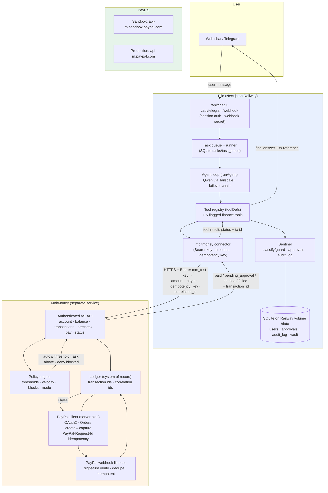

# Elio × MoltMoney × PayPal — READ-ONLY Architecture Audit

**Status:** Discovery & planning only. Zero code changed. Zero tools added. Zero config touched.
**Sources inspected:** `src/lib/agent/loop.ts`, `src/lib/agent/tools.ts`, `src/lib/agent/runner.ts`, `src/lib/sentinel.ts`, `src/lib/db.ts`, `src/lib/auth.ts`, `src/lib/vault.ts`, `src/lib/scheduler.ts`, `src/lib/llm/index.ts`, `src/lib/llm/types.ts`, `src/middleware.ts`, `src/app/api/chat/route.ts`, `src/app/api/approvals/route.ts`, `src/app/api/telegram/webhook/route.ts`, `src/lib/connectors/gmail.ts`, `.env.example`.
**External docs (official PayPal):** developer.paypal.com `/api/get-started/`, `/api/make-api-requests`, `/sandbox-testing/overview/`, `/api/rest/webhooks/`, `/ai-tools/mcp-server/` (all fetched current, 2026).

---

## 1. CURRENT ELIO ARCHITECTURE

**Entry points:**

| Entry | Path | Auth | What it does |
|---|---|---|---|
| Web chat | `POST /api/chat` | `elio_session` cookie (middleware) | persists message → fast-path digest commands → memory extraction (void) → `createTask` + `enqueueTask` |
| Task polling | `GET /api/chat?taskId=` | cookie | returns task + steps + messages + pending approvals for that task |
| Telegram | `POST /api/telegram/webhook` | public + `x-telegram-bot-api-secret-token` header check | owner chat-id lock (vault), `update_id` dedupe, slash commands, background `runAgent` |
| Approvals API | `GET/POST /api/approvals` | cookie | list / resolve approvals; resumes waiting tasks |
| Scheduler | in-process `setInterval` | n/a (server-side) | digests (morning/evening + boot catch-up), reminders (1-min tick), monitors; digest-email retry queue |
| LLM providers | `getAdapter()` | env keys | `qwen` (Railway: `railtail.railway.internal`), `cleanapis`, `gemini`, `groq`, failover chain on rate-limit errors |

**Agent loop (`runAgent`):** max 14 steps; system prompt + `memoryContext()` + `digestContext()`; prior 12 messages; per step: `toolsForStep()` gating (Tier-1: NONE only for pure small-talk at step 0; fail-open to FULL; `TOOL_GATING` kill-switch; `TOOL_NAMES` escape-hatch regex; `priorToolActivity()` DB check; gate-recovery re-call), `adapter.complete()`, tool execution via `getTool()`, `redact()` before step logs, browser-snapshot compaction, `task_complete` as terminal tool. Tool exceptions become `Tool error: …` tool messages — the loop continues; only exceptions escaping the loop fail the task.

**Task queue:** in-memory `queue` + `processing` flag, serialized single-process; tasks persist in SQLite `tasks`/`task_steps` so the tab can close. `retryTask` clones failed tasks. **Implication:** approvals block the worker (`waitForApproval` polls up to 15 min inside the connector) — a pending financial approval would pause all queued tasks behind it.

**Memory:** `remember`/`forget` tools + background `extractMemories()`; `memoryContext()` injected into the system prompt. Memories are global, not per-user.

**DB:** `node:sqlite` (WAL, `busy_timeout=5000`, lazy build-safe open), `data/muse.db` at `ELIO_DATA_DIR`‖`MUSE_DATA_DIR`‖`cwd/data`. Tables: users, sessions, settings, conversations, messages, tasks, task_steps, approvals, audit_log, memories, vault_secrets (AES-256-GCM), connector_grants, digests, reminders, monitors, password_resets.

**Where a financial tool fits:** exactly one place — a new `AgentTool` entry in the `TOOLS` array in `tools.ts`, its `run` in a new `src/lib/connectors/moltmoney.ts`, Sentinel rules for `finance.*` actions, and the tool names added to the `TOOL_NAMES` escape-hatch regex in `loop.ts` (one line). Note `TASK_SIGNALS` already contains `buy` and `order`, so a real purchase request already passes the step-0 gate to FULL; the regex addition is hygiene for explicit tool-name mentions.

## 2. CURRENT TOOL SYSTEM

- **Definition:** `AgentTool { def: ToolDef; run(ctx, args) }`. `ToolDef = { name, description, parameters: JSON Schema }` — the shape OpenAI-compatible providers accept; the Gemini adapter normalizes to `functionDeclarations`.
- **Registry:** single `TOOLS: AgentTool[]`; `getTool(name)`; `toolDefs()` returns the 26 defs.
- **Execution:** `runAgent` JSON-parses `tc.args`, builds `ToolContext { taskId, conversationId }`, awaits `tool.run(ctx, args)`; result string sliced to 12,000 chars into the next `role:"tool"` message.
- **Failure handling:** thrown errors become `Tool error: …` strings back to the model (loop survives); no tool-layer retry exists.
- **Approval-required tools:** gating lives **inside the connector**, not the loop: `guard({action:"gmail.send", …})` → if `ask`, insert `approvals` row, `await waitForApproval(15 min)` inside the connector, then act. The `waiting_approval` task status exists in the schema and `resumeTaskForApproval` flips it to `running`, but `runner.ts` never *sets* it today — the UI just sees a long-running task while the connector blocks.
- **Long-running tools:** none today except the blocking approval wait; monitors/digests run outside the loop (scheduler), report-only.
- **Lazy connector imports:** `run` bodies do `import("../connectors/x")` — a MoltMoney connector can be added without touching the loop at all.

**Exposure options:**

- **A. Native Elio tools** — matches the existing `AgentTool` contract exactly; Sentinel gating in connector; `audit_log` integration free; polling UX unchanged; minimal new machinery.
- **B. MCP tools** — Elio has **no MCP client infrastructure** (no SDK, no tool-bridge). Adding one means a new runtime dependency and a second tool-discovery path, conflicting with "do not refactor the agent loop". PayPal's remote MCP also speaks OAuth login/consent flows designed for interactive clients (Claude/Cursor), not headless service-to-service.
- **C. Plain API integration (non-tool)** — e.g. a balance panel only. Doesn't let Elio *act*, which is the point.
- **D. Hybrid (recommended):** **native Elio tools as the agent-facing surface**, each a thin client to **MoltMoney's authenticated API**; MoltMoney — not Elio — owns PayPal credentials, policy thresholds, idempotency keys, and the PayPal webhook listener. If MoltMoney later exposes its own MCP server, Elio can add an MCP bridge as an *alternative MoltMoney client* without changing the tool surface. This keeps Elio→MoltMoney as a clean **service-to-service REST boundary** — also the clearest hackathon/demo story (one chain, no protocol zoo).

## 3. CURRENT APPROVAL SYSTEM (Sentinel)

- **Who decides:** `classify(action)` — regex rule table; unknown actions **fail closed to `ask`**. `guard()` = classify + `audit_log` + create `approvals` row when `ask`. `waitForApproval` polls the row every 1.5 s up to 15 min, then marks `expired`. `resolveApproval` flips `approved`/`denied` + audits. `POST /api/approvals` resolves from the UI card. Plain "yes" in chat does **not** approve (explicit, tested design).
- **Existing money-relevant rule:** `/^payment\./` → high risk, `ask` ("Spending money always requires explicit human approval.") — **with no amount-awareness**: $1 and $5,000 hit the same single rule.
- **Can it support the target policy set?** Partially:
  - ✅ human-approval-always (`ask`), blocked classes (`deny`), audit logging, non-bypassable by chat-yes, expiry, fail-closed unknowns.
  - ❌ **no amount thresholds** (`RULES` match on action string only; `guard()` never sees an amount); ❌ no per-connector/per-user limits; ❌ no velocity limits; ❌ approval binds to an `approvalId`, not to an immutable payment intent (the connector proceeds *after* approval with whatever args it re-holds); ❌ no policy-driven "auto-approve below X" tier distinct from the regex-decided `allow`.
- **Verdict — the stated principle is correct:** **MoltMoney must be the financial authorization authority.** Elio's Sentinel remains the *general* gate (still `ask` for `finance.pay` as the human checkpoint), while **amount thresholds, budgets, velocity, blocked-merchant/currency lists, and the final authorization decision live in MoltMoney**, which sees the real ledger. Defense in depth — neither layer alone suffices: Sentinel can't do thresholds (no amount model); MoltMoney can't distinguish "user asked Elio in chat" from "user clicked approve".

## 4. CURRENT AUTHENTICATION

- **User auth:** scrypt password hashing (`scryptSync` 64-byte, per-user salt), `sessions` table with random 32-byte token, `elio_session` cookie 30 d. Middleware checks **cookie presence only** (it does not verify the session); `validateSession` runs in route handlers via `getCurrentUser`. API without cookie → 401 JSON; pages → redirect `/landing`. `PUBLIC_PATHS` includes the Telegram webhook, auth/oauth, static assets.
- **Webhook auth:** Telegram route self-authenticates via secret-header equality + owner chat-id lock.
- **Secrets:** `VAULT_SECRET` env → scrypt → AES-256-GCM `vault_secrets`; connectors resolve `{{vault:label}}` surrogates at call time; `redact()` scrubs vault tokens/Bearer tokens/AIza/GitHub tokens/emails from step logs. Provider keys live in Railway env, referenced server-side only.
- **Server/client boundary:** all LLM/tool/DB code is server-side (`runtime="nodejs"`); the client is a polling UI. New connector code must stay in `src/lib/**` imported only by server code.

## 5. CURRENT PRODUCTION BOUNDARIES

- **Deploy:** Railway, single Node process (scheduler + queue in-process). **⚠️ Known open issue:** SQLite lives in the container layer — **DB wiped on every redeploy** unless a Railway Volume is mounted at `/data` with `ELIO_DATA_DIR=/data` (user-side; documented in `docs/RAILWAY.md`; verify via the `[elio] database:` boot log). **This is a hard blocker for finance:** audit_log, approvals, and payment references *must* survive redeploys, and idempotency records must not vanish mid-payment.
- **Runtime:** single process; WAL SQLite; safe for one-user production; a hung `waitForApproval` blocks the queue (see §3).
- **Secrets:** `VAULT_SECRET`, LLM keys, Telegram token/secret in Railway env; per-connector tokens encrypted in DB via the vault.
- **Tool execution boundary:** server-side only; the model never sees real secrets (surrogates + `redact()`); the browser connector refuses card/password entry (system prompt).
- **Background workers:** none external (no Redis/cron service) — the in-process scheduler is it.
- **Safest introduction path:** (1) fix the Railway volume first (user-side prerequisite); (2) ship the MoltMoney connector + tools **behind a feature flag** (`MOLTMONEY_ENABLED=false` default); (3) flag off → `toolDefs()` excludes finance tools → zero model-visible change; (4) sandbox mode only; (5) approval-required by default; (6) no changes to LLM providers, the loop, or existing tools.

## 6. PROPOSED MOLTMONEY CONNECTION

**Auth recommendation:** long-lived **API key per environment** (`MOLTMONEY_API_KEY`) sent as `Authorization: Bearer <key>`; optionally plus an HMAC request-signing header (key-derived over body+timestamp+nonce) later, so a leaked Bearer alone can't replay unsigned writes. HTTPS only; MoltMoney must reject non-TLS. For the hackathon, Bearer + HTTPS suffices; HMAC is a documented hardening step, not phase 1.

- **Timeouts:** ~10 s for reads; ~20 s for payment create/capture (PayPal can be slow; MoltMoney should return its own `pending` + status reference rather than blocking long).
- **Retries:** idempotent reads: up to 2 retries on 429/5xx/timeout with jittered backoff. **Money-moving calls: retry ONLY with the same `requestId` (idempotency key)** — never blind retries; a create-payment retried without the same key risks duplicate money movement.
- **Idempotency:** Elio generates a stable **`requestId`** (uuid) **before** the Sentinel approval and passes it on every attempt of that logical payment; MoltMoney dedupes on it. Aligns with PayPal's own `PayPal-Request-Id` (stored up to 45 days per official docs). (Today's `approvals` table has no meta column — carry the key in the approval `detail` or add a column later; noted as a required change, not made.)
- **Correlation IDs:** Elio's `taskId` flows through every MoltMoney call as `correlation_id` (+ `conversation_id`), so MoltMoney ledger rows and PayPal webhook events trace back to the exact chat task. Require MoltMoney to echo both in responses and webhooks.
- **Error handling:** map MoltMoney errors to redacted model-visible tool results: `policy_denied` / `insufficient_funds` / `approval_required` / `provider_error` / `timeout` / `unknown` — with the MoltMoney transaction id present in **every** outcome (needed for reconciliation). Non-2xx never throws unhandled into the loop; return structured tool results.
- **Contract sketch (Elio→MoltMoney):**
  - `GET /v1/account` → account id, currency, mode, provider links
  - `GET /v1/balance`
  - `GET /v1/transactions?limit&cursor`
  - `POST /v1/payments/precheck` `{ amount, currency, payee }` → `{ policy: auto_approve|approval_required|denied, reason }` (read-only)
  - `POST /v1/payments` `{ amount, currency, payee, description, idempotency_key, correlation_id }` → `{ status: paid|pending_approval|denied|failed, transaction_id, provider_reference? }`
  - `GET /v1/payments/{id}`
  - `POST /v1/payments/{id}/refund` (phase 2)
  - `POST /v1/webhooks/elio` (MoltMoney→Elio, phase 2; reuse the Telegram secret-header pattern)

## 7. PROPOSED FINANCIAL TOOLS (design only)

Minimal safe set for the first sandbox integration — **5 tools, not 8**:

| Tool | Purpose | Input | Output | Read-only | Moves money | Human approval (Sentinel) | Who enforces authorization |
|---|---|---|---|---|---|---|---|
| `moltmoney_get_account` | Confirm link + account + mode | `{}` | `{ account_id, currency, mode: sandbox\|production, provider, limits? }` | ✅ | ❌ | allow (low) | n/a |
| `moltmoney_get_balance` | Current balance | `{}` | `{ balance, currency, as_of }` | ✅ | ❌ | allow (low) | MoltMoney scopes read |
| `moltmoney_get_transactions` | Recent history for reconciliation | `{ limit?, cursor? }` | `{ transactions[{id, amount, currency, status, created_at, description}], next_cursor? }` | ✅ | ❌ | allow (low) | MoltMoney scopes read |
| `moltmoney_pay` | Submit a payment through MoltMoney | `{ payee, amount, currency, description, purpose? }` | `{ status: paid\|pending_approval\|denied\|failed, transaction_id, provider_reference?, policy_reason? }` | ❌ | ✅ | **ask** (high) — always, phase 1 | **MoltMoney** (thresholds/velocity/blocks) + Sentinel as human checkpoint |
| `moltmoney_get_payment` | Check status of one payment | `{ transaction_id }` | `{ transaction_id, status, amount, currency, timestamps }` | ✅ | ❌ | allow (low) | MoltMoney scopes read |

**Explicitly deferred (not needed for sandbox):** `request_refund` (refund = money movement + dispute semantics; run through MoltMoney console/PayPal dashboard for now — phase 2), `get_spending_limits` (fold into `get_account`), the `create_payment` vs `request_payment` split (one `moltmoney_pay` suffices; MoltMoney's `pending_approval` response *is* the "request" outcome), inbound `request_payment` (out of scope).

**Design rules encoded above:** one choke-point tool for all money movement; read-only tools never expose other accounts' data (MoltMoney enforces per-key scoping); every mutating call returns a `transaction_id` no matter the outcome (reconciliation + §12); tool descriptions state "REQUIRES HUMAN APPROVAL" exactly like `gmail_send`/`browser_submit` do today; **amounts as strings** (`"10.00"`) — never floats for money.

## 8. PAYPAL ARCHITECTURE OPTIONS

Official docs establish the primitives: REST + OAuth 2.0 client-credentials access tokens (`POST /v1/oauth2/token` with client id/secret, ~9 h token lifetime); base URLs `https://api-m.sandbox.paypal.com` and `https://api-m.paypal.com`; `PayPal-Request-Id` idempotency header ("recommended for all POST and PUT"; dedupe stored up to 45 days); webhooks (subscribe URL per app, up to 10 per app; verify via CRC+signature or PayPal's verify endpoint; non-2xx → redelivery up to 25× over 3 days); sandbox = self-contained mirror with personal + business accounts; and a PayPal MCP server (local `npx @paypal/mcp` or remote `mcp.sandbox.paypal.com/sse|/http` with client-credentials bearer, OAuth login/consent).

- **Architecture A — Elio → PayPal direct:** ❌ Not recommended. Puts the PayPal client secret in Elio's env — violates the stated principle ("Elio should NOT directly own PayPal credentials"); Elio must then implement OAuth token caching, `PayPal-Request-Id` idempotency, webhook verification, a policy engine, and a ledger — every one of those is MoltMoney's *raison d'être*. Fragments audit across two ledgers; any future provider (Stripe, etc.) reopens Elio.
- **Architecture B — Elio → MoltMoney → PayPal direct APIs (recommended):** ✅ MoltMoney holds PayPal client id/secret server-side, manages OAuth tokens, runs the policy engine, uses its transaction id as `PayPal-Request-Id`, listens to PayPal webhooks (signature verification, redelivery-tolerant, idempotent), owns the ledger, and exposes the simple `/v1` API from §6. Elio stays provider-agnostic. MoltMoney `pending_approval` maps cleanly onto PayPal **Orders v2** where **create order ≠ capture** — authorization and execution are separate steps, matching "MoltMoney authorizes, PayPal executes". *Hackathon implication:* the cleanest demo narrative — chat → approval card → policy verdict → webhook confirmation → chat confirmation — with one diagram chain and real sandbox money movement.
- **Architecture C — Elio → MoltMoney → PayPal MCP:** ⚠️ Evaluate, don't default. PayPal's MCP is a *merchant-assistant* surface (invoices, disputes; interactive OAuth consent in clients like Claude/Cursor). Between MoltMoney and PayPal it means MoltMoney's policy engine sees tool/natural-language semantics instead of typed API responses, while webhooks still require direct API subscription regardless. MCP adds protocol machinery exactly where MoltMoney needs deterministic, idempotent REST.

## 9. PAYPAL MCP ASSESSMENT

- **Elio using PayPal MCP directly:** ❌ No. Even more disqualifying than C: credentials land on Elio's side; interactive OAuth consent; no Sentinel integration; PayPal's own docs note MCP-client tech "can come with performance issues or other challenges initially". Elio also has no MCP client stack; adding one contradicts the no-refactor constraint.
- **MoltMoney → direct PayPal APIs:** ✅ Yes — the primary path (Architecture B).
- **MoltMoney exposing its own MCP interface:** optional, phase 3+. A nice garnish ("any MCP client can ask MoltMoney for a balance"), zero value for Elio's reliability goals, real cost (MCP transport auth, per-user mapping). Postpone.
- **Coexistence:** possible later (Elio tools→REST; other MCP clients→MoltMoney MCP) without touching Elio — not a phase-1 concern.
- **Overall: postpone MCP.** The reliable, secure hackathon implementation is typed REST between Elio and MoltMoney, direct PayPal REST + webhooks inside MoltMoney.

## 10. SECURITY MODEL

Layered, with Elio holding **no PayPal credentials**:

1. **Transport:** Elio→MoltMoney HTTPS + Bearer API key (+ optional HMAC later); MoltMoney→PayPal official OAuth2 client-credentials.
2. **Authorization layers (all three, in order):** Elio Sentinel (`finance.pay` → high/ask; `finance.read` → low/allow) → MoltMoney policy engine (thresholds, velocity, blocklists, mode enforcement) → PayPal native risk.
3. **Identity binding:** the MoltMoney API key is scoped to Elio-as-client with a per-account scope; every request carries `correlation_id` = Elio taskId; MoltMoney rejects cross-account references.
4. **Secrets:** no PayPal secret ever in Elio env, DB, or logs. Elio's MoltMoney key: Railway env var only, never client-side; give it a recognizable prefix (`mm_test_…`/`mm_live_…`) so `redact()`'s existing `Bearer`/`sk-`-style patterns keep it out of step logs; optionally add a dedicated pattern.
5. **Audit:** every `finance.*` action → `audit_log` (risk=high for pays); approval rows get status transitions only; MoltMoney's ledger is the system of record for money; Elio stores only references.
6. **LLM-layer hardening:** tool descriptions state the approval requirement; the system prompt already forbids approving via chat; **prompt-injection rule for finance: Elio never derives payee or amount from untrusted web content** — they must originate from the user's own utterance or a user-approved plan; MoltMoney can additionally enforce a per-account payee allowlist.
7. **Least privilege:** first integration is sandbox-mode-only; production keys live only in MoltMoney; Elio's key is unilaterally revocable.

## 11. APPROVAL MODEL

| Policy | Implemented by |
|---|---|
| Auto-approve below threshold | **MoltMoney** policy engine (e.g. `auto_approve_below: 5.00 USD`) → `status: paid` without human action. Phase 1 keeps Sentinel `ask` for **all** pays (safest); phase 2 lets Elio consult MoltMoney's precheck verdict so policy-auto payments skip the card |
| Human approval above threshold | MoltMoney verdict `pending_approval` → existing Elio approval card |
| Blocked transactions | MoltMoney `policy_denied` (Elio reports, never retries) + optional Elio-side Sentinel `deny` rules (e.g. currency allowlist) |
| Explicit user confirmation | Existing approvals card + `waitForApproval` + no-chat-yes guard — unchanged |
| Audit logging | Existing `audit_log` + MoltMoney ledger |

Recommended `moltmoney_pay` flow: (1) `POST /v1/payments/precheck` (read-only) → MoltMoney verdict `{auto_approve|approval_required|denied, reason}`; (2) Elio states the verdict; (3) Sentinel approval card for anything not auto-approved; (4) on approval, `POST /v1/payments` with the **pre-generated `requestId`** and correlation ids; (5) MoltMoney executes via PayPal; (6) response/webhook confirms; (7) Elio reports the transaction id. The model's narrative stays: **determine → verify → authorize → execute → confirm → reference**.

## 12. ERROR-HANDLING MODEL

| Scenario | Elio behavior (tool result to model) | Money safety |
|---|---|---|
| PayPal unavailable | MoltMoney returns `provider_error` → "PayPal is temporarily unavailable; payment not made. Ref: tx_123" | no funds moved (MoltMoney ledger confirms) |
| MoltMoney unavailable | connector timeout ~10 s → "MoltMoney unreachable — financial actions paused" | **fail closed**: no retry loop, no local fallback execution |
| Payment times out | never blind-retry; re-check via `moltmoney_get_payment`; report actual status | idempotency key prevents double-capture |
| Payment duplicated (model calls pay twice) | MoltMoney dedupes by `idempotency_key`; same key per logical payment; distinct intents get distinct keys | `PayPal-Request-Id` as last line of defense |
| PayPal returns an error | surface MoltMoney-mapped error + tx ref | ledger records failure; no partial state exposed |
| Success but response lost | status-check tool; MoltMoney webhook (phase 2) reconciles | PayPal webhook is MoltMoney-side truth; ledger reconciles |
| Webhook late / arrives twice | MoltMoney-side: verify signature + dedupe by event id (Elio's Telegram `update_id` dedupe is the template); Elio: only status-tool results are user-facing | idempotent handlers |
| Insufficient funds | `insufficient_funds` verdict → report, no retry | nothing moved |
| Exceeds policy | `policy_denied` + reason → report; raising limits is a *user* action in MoltMoney, not an agent action | nothing moved |
| Approval denied | "Payment was NOT made (approval denied or timed out)" — matches `gmail_send` wording | nothing moved |
| Approval expires | `waitForApproval` → `expired`; same message as denied; a re-request creates a fresh approval + fresh intent | nothing moved; no stale approval reuse |

## 13. SANDBOX TESTING PLAN (design only)

Per the official sandbox guide (self-contained mirror; personal + business sandbox accounts; developer dashboard):

1. **Prereqs (user-side):** PayPal developer account; create a REST app → sandbox client id/secret **goes to MoltMoney**; note the auto-created personal + business sandbox accounts.
2. **MoltMoney sandbox mode:** `mode=sandbox`, sandbox PayPal creds in MoltMoney env, ledger + policy engine live, test thresholds (e.g. auto <$5, ask $5–50, deny >$50 — test values only).
3. **Elio integration tests (vitest, no network):** connector unit tests with mocked MoltMoney fetch (success / `policy_denied` / `pending_approval` / `insufficient_funds` / 500 / timeout); Sentinel rules for `finance.*`; idempotency-key stability (same logical payment → same key across retries); redaction test for `mm_test_` keys. Follows existing suites (tools/sentinel/gmail; 158/158 baseline).
4. **End-to-end sandbox via chat:** "Buy a test item for $3.00 from the sandbox personal account" → expect policy=auto or approval card; PayPal sandbox money moves personal→business; `moltmoney_get_transactions` shows it; task summary includes the tx id. Then a $25 one → card → approve → paid. Then deny one. Then let one approval expire (15 min).
5. **Failure drills:** stop MoltMoney mid-flow; capture timeout; duplicate pay calls (same and different keys); late webhook replay.
6. **Verification harness:** each drill asserts on (a) tool result text, (b) `audit_log` rows, (c) MoltMoney ledger state, (d) the PayPal sandbox test site transaction list.
7. **$10 / ~ZAR160 real-world test (design only, later phase):** controlled production credentials in MoltMoney only; `mode=production` gate + explicit allowlist; amount cap env (`MOLTMONEY_MAX_REAL_AMOUNT=10.00`); precheck → approval card → execute → verify via PayPal activity + MoltMoney ledger + `moltmoney_get_payment` → optional small refund drill via the MoltMoney console; monitoring = `audit_log` + ledger diff + the existing Telegram result push (`notifyTaskResult`). Confirm PayPal ZAR support for the receiving account before the real test.

## 14. PRODUCTION MIGRATION PLAN

Ordered, reversible at every step:

1. **(User-side, prerequisite)** Railway Volume at `/data` + `ELIO_DATA_DIR=/data`; redeploy; verify the `[elio] database:` boot log shows `/data/muse.db`. **Do not start production finance before this.**
2. **MoltMoney:** sandbox API + ledger + policy engine + PayPal sandbox credentials (their repo, their timeline).
3. **Elio (flagged, sandbox-only):** connector + 5 tools + Sentinel `finance.*` rules + `TOOL_NAMES` regex + redact pattern + env + tests; `MOLTMONEY_ENABLED=false` in production until step 5.
4. **Sandbox E2E drills** per §13, including all failure scenarios; assert on audit_log + ledger + sandbox site.
5. **Enable sandbox-mode in production** (`MOLTMONEY_ENABLED=true`, `MOLTMONEY_MODE=sandbox`) — the real user gets the capability with fake money; approval-card UX validated on the volume-mounted DB.
6. **The $10/ZAR160 real test** per §13.7: production creds in MoltMoney only, mandatory approval card, Telegram confirmation, post-transaction verification + refund drill.
7. **Phase 2 policy work:** Sentinel consults MoltMoney precheck so auto-approvable payments skip the card; MoltMoney→Elio webhook for async confirmations; optional refund tool; optional MoltMoney MCP (postponed, §9).

**Rollback at any point:** `MOLTMONEY_ENABLED=false` (tools vanish from `toolDefs()` — no schemas, no model exposure) or `MOLTMONEY_MODE=sandbox`. Any DB additions are new tables only — additive, non-destructive.

## 15. REQUIRED ENVIRONMENT VARIABLES (design only)

```
# ── MoltMoney (Elio side) ────────────────────────────────
MOLTMONEY_ENABLED=false            # kill-switch; false → finance tools not registered
MOLTMONEY_BASE_URL=                # e.g. https://api.moltmoney.com (or an internal/tailscale URL)
MOLTMONEY_API_KEY=                 # mm_test_… / mm_live_… (prefix keeps redact() effective)
MOLTMONEY_MODE=sandbox             # sandbox | production (Elio-side display; MoltMoney enforces for real)
MOLTMONEY_TIMEOUT_MS=10000         # reads; money-moving calls use 2×
MOLTMONEY_WEBHOOK_SECRET=          # phase 2: verify MoltMoney→Elio webhook (Telegram secret-header pattern)

# ── MoltMoney-side (their app; shown for the contract only) ──
# PAYPAL_CLIENT_ID / PAYPAL_CLIENT_SECRET (sandbox or live)
# PAYPAL_MODE=sandbox|production
# PAYPAL_WEBHOOK_ID                # for webhook signature verification
# Policy thresholds: auto_approve_below, approval_required_above, blocked payees/currencies
```

None added yet. `VAULT_SECRET` unchanged. **No PayPal variables belong in Elio's env.**

## 16. REQUIRED ELIO CODE CHANGES (design only)

1. **`src/lib/connectors/moltmoney.ts`** (new): typed fetch client (timeouts, retry-with-same-key, error mapping) + `moltmoneyPay(ctx, args)` implementing guard → `waitForApproval` → precheck → pay, reusing `guard`/`waitForApproval`/`audit`/`addStep`.
2. **`src/lib/agent/tools.ts`**: 5 `AgentTool` entries pushed into `TOOLS` only when `process.env.MOLTMONEY_ENABLED === "true"` — flag-off means zero model-visible delta.
3. **`src/lib/sentinel.ts`**: add `finance.read` (low/allow), `finance.pay` (high/ask), `finance.refund` (high/ask, future); unknown actions keep failing closed.
4. **`src/lib/agent/loop.ts`**: add the 5 tool names to the `TOOL_NAMES` escape-hatch regex (one line; no logic change).
5. **`src/lib/vault.ts`**: add an `mm_(test|live)_…` pattern to `SECRETISH_PATTERNS`.
6. **`.env.example`**: the MoltMoney block from §15.
7. **Tests:** connector mocks, Sentinel rules, key stability, redaction (§13.3).
8. **NOT touched:** loop logic, LLM adapters/providers, existing tools, `runner.ts`, DB DDL (a local `finance_payments` cache table is *optional* later — MoltMoney is the system of record; don't duplicate the ledger locally).

## 17. REQUIRED MOLTMONEY CODE CHANGES (their side, design only)

1. **Auth:** API keys (`mm_test_`/`mm_live_`) with per-account scope; HTTPS-only; optional HMAC request signing (phase 2 hardening).
2. **API surface** (§6 contract): account / balance / transactions / precheck / pay / status; every response echoes `correlation_id` + `transaction_id`.
3. **Policy engine:** amount thresholds, velocity, blocked payee/currency lists, mode gate; verdicts `auto_approve|approval_required|denied` with reasons.
4. **PayPal integration (server-side only):** OAuth2 client-credentials token caching with refresh-before-expiry (per get-started docs); Orders v2 create→authorize→capture with `PayPal-Request-Id` = MoltMoney transaction id; map PayPal error codes to MoltMoney error codes.
5. **Webhooks:** subscribe a PayPal webhook endpoint; **verify signatures** (CRC+signature or PayPal's verify endpoint per docs); dedupe by event id (Telegram dedupe pattern); redelivery-tolerant and idempotent (PayPal retries non-2xx up to 25×/3 days); update ledger status; optional MoltMoney→Elio webhook (secret-header pattern).
6. **Ledger:** system of record; immutable transaction rows; reconciliation job vs PayPal activity; refund path (phase 2).
7. **Ops:** audit trail of policy decisions; per-key rate limiting; structured logs carrying correlation ids.

## 18. RISKS / BLOCKERS

| # | Risk | Severity | Mitigation |
|---|---|---|---|
| 1 | **Railway DB wipe on redeploy** — approvals/audit/idempotency records vanish | 🔴 Blocker for production finance | User-side volume mount (§14.1); verify via boot log |
| 2 | Sentinel has no amount model — Elio-side auto-approve-below-threshold impossible | 🟠 High | MoltMoney owns amounts (principle confirmed); Sentinel asks for all pays in phase 1 |
| 3 | Single-process queue: a 15-min approval wait blocks subsequent tasks | 🟠 Medium | Phase 1: accept (single-user production); phase 2: set `waiting_approval` in runner / move approval wait off the queue |
| 4 | Model duplication of `moltmoney_pay` calls | 🟠 Medium | Pre-generated idempotency key stored before approval; MoltMoney dedupe; `PayPal-Request-Id` |
| 5 | Prompt injection via web content steering payments | 🔴 High | Payee/amount must originate from user utterance; MoltMoney payee allowlist; Sentinel + policy double gate; audit |
| 6 | PayPal MCP temptation | 🟢 Low | Postponed (§9); direct REST inside MoltMoney |
| 7 | Key leak into step logs / model context | 🟠 Medium | `redact()` pattern; connector never logs auth headers; tool results exclude headers |
| 8 | Sandbox→production confusion (wrong creds, real money) | 🔴 High | Mode gates in both apps; amount cap env; payee allowlist; mandatory approval card for real money |
| 9 | MoltMoney downtime pauses agent finance | 🟢 By design | Fail closed; report unavailability; never queue-and-forget money requests |
| 10 | ZAR currency support for the real test | 🟠 Medium | Confirm PayPal ZAR handling for the receiving account before the live test; sandbox is currency-agnostic |
| 11 | `waitForApproval` expiry (15 min) vs user expectations for money | 🟢 Low | Timeout message offers an explicit re-request; fresh approval each time |

## 19. IMPLEMENTATION ORDER

1. **User-side:** Railway volume `/data` + `ELIO_DATA_DIR=/data`; redeploy; verify `[elio] database:` log shows `/data/muse.db`; re-link Telegram, reconnect Gmail.
2. **MoltMoney:** sandbox API + ledger + policy engine + PayPal sandbox credentials.
3. **Elio (flagged, sandbox-only):** connector + 5 tools + Sentinel rules + regex/redact/env + tests; production flag stays `false` until step 5.
4. **Sandbox E2E drills** (§13) incl. all failure scenarios; assert on audit_log + ledger + sandbox site.
5. **Enable sandbox-mode in production** (flag on, mode=sandbox); validate approval-card UX with real usage.
6. **$10/ZAR160 real test** (§13.7): production creds in MoltMoney, mandatory approval, verify + refund drill, monitor via Telegram push + audit_log.
7. **Phase 2 policy work:** Sentinel consults precheck for auto-approvable payments; MoltMoney→Elio webhook; optional refund tool; optional MoltMoney MCP (postponed, §9).

---

## Recommended eventual architecture



**One-line summary:** Elio stays an agent — it asks; MoltMoney decides (policy authority, PayPal credential holder, ledger, webhook owner); PayPal executes; the human stays in the loop through the existing Sentinel approval card for anything above policy; and everything ships flagged, sandboxed, and reversible before a single cent moves.
